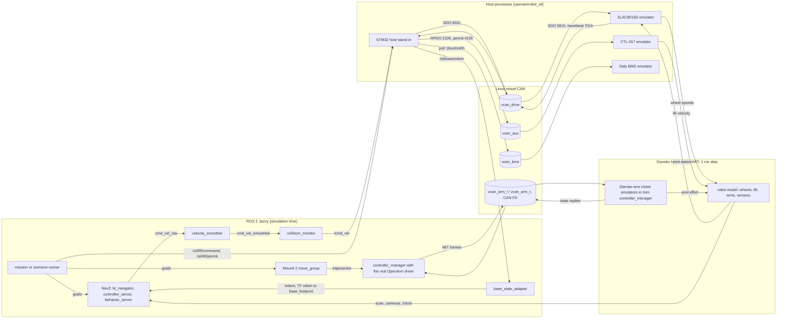

# Architecture and data flow

**For:** engineers who need to know where a piece of the twin lives and what it talks to.

**Canonical source:** the Build 1 scene README and `config/command_map.yaml` in
[openamr-upperbody-sw `integration/baseline1`](https://github.com/openAMRobot/openamr-upperbody-sw/tree/196dd3fe64900ba4a12124c9ee20e0cfaafa1651/ros2/src/openamrobot_build1_scene),
and [`docs/demo/can_signal_paths.md`](https://github.com/openAMRobot/openamr-upperbody-sw/blob/d39a648/docs/demo/can_signal_paths.md)
(pull request #84, open). This page describes the device profile `firmware_sil` with the STM32 slot `host`, which
the Baseline 1 runs use.

!!! warning "Simulation, not hardware validation"
    Every box below is software. Nothing on the virtual buses is a real device.

## The system in one picture

## How a command travels

1. **Goal.** The mission sends Nav2 a `navigate_to_pose` goal (or MoveIt a motion request).
2. **Velocity.** Nav2's controller publishes on `cmd_vel_nav`. `velocity_smoother` limits acceleration and writes
   `cmd_vel_smoothed`; `collision_monitor` can slow or stop on obstacles and is the only writer of `/cmd_vel`.
3. **Into CAN.** The host stand-in of the STM32 base controller subscribes to `/cmd_vel`, converts it to wheel speeds in
   r/min (wheel radius 0.098 m, separation 0.400 m from its `sil.yaml`) and writes them every 20 ms of simulation time
   as CANopen SDO writes to the drive on `vcan_drive`.
4. **Drive.** The ZLAC8015D emulator runs a reduced CiA 402 state machine and a ramp, and hands the wheel demand to
   Gazebo through `wheel_command_adapter`, one velocity input per wheel.
5. **Physics.** Gazebo moves the wheels and the robot on the floor.
6. **Feedback.** The emulator reads the wheel speeds back from Gazebo and answers the stand-in's SDO reads.
   `base_state_adapter` integrates them over simulation time into `/odom` and the `odom` to `base_footprint` transform.
   AMCL corrects `map` to `odom` from the LiDAR scan.

The lift and the arms follow the same pattern on their own buses: [Electronics and CAN buses](electronics-and-can.md)
lists every step. Each joint and each command topic has exactly one writer per profile (the single-writer map,
`config/command_map.yaml`), checked by a test and by scenario 9 on the running system.

## Three clocks

| Clock | Used for |
|---|---|
| Gazebo time on `/clock` | every ROS node, the driver's controller manager, every scenario limit, the emulator cycles |
| host monotonic time | some emulator timers (ZLAC8015D link-loss and heartbeat until a firmware change is vendored), CAN dump time stamps |
| Renode virtual time | the firmware image, only with `stm32:=renode_readonly` |

They are not synchronised. A scenario waits in Gazebo time with a wall limit twenty times longer, so a slow machine
does not fail a check. Details: [Electronics and CAN buses](electronics-and-can.md#clock-model).

## Run profiles

| Profile | Devices | What drives the joints |
|---|---|---|
| `firmware_sil` (default) | emulators on virtual CAN, host stand-in or firmware in Renode, real arm driver | the device path above |
| `faults` | as `firmware_sil` | as `firmware_sil`; faults are injected |
| `fast` | none | `gz_ros2_control` controllers and the base DiffDrive plugin, 1 ms step |
| `fine` | none | as `fast`, 1/1500 s step |

## Target architecture

The project's target adds the hardware behaviour models connected to the physics, Isaac Sim for perception, firmware
in the loop for the real base controller and an evidence register for every run. The drawing below is that target, not
the current state; [Current status](status.md) says what runs today.

## What stays out of the twin

- The hardwired safety chain: E-stops, contactors, brakes and charge inhibit. No part of the twin is a safety function.
- The CAN physical layer: bit timing, arbitration, error frames, bus-off and cabling. Virtual CAN delivers at once.
- Electrical and thermal behaviour, battery behaviour under load, power distribution.
