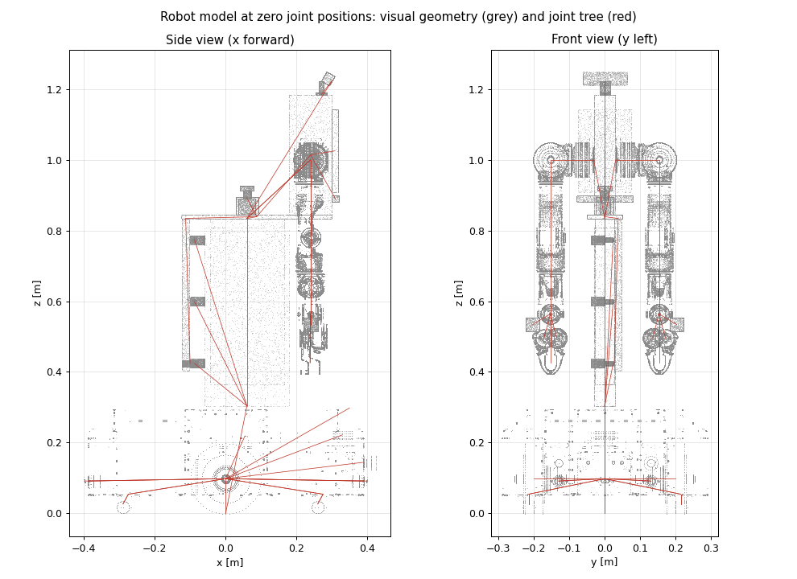

# Digital twin media

!!! note "No videos yet"
    Videos of the digital twin will be added here once a capture passes review: recorded from a pinned commit, with the
    run profile and engine named, and labelled as simulation. Until then this page stays empty on purpose. No rendered
    or staged material stands in for a capture.

## Robot model

*Generated model geometry at zero joint positions; not a simulator capture.*

[Architecture diagrams and runtime ROS 2 graph](rc1/diagrams.md) · [Run the demonstrations](rc1/demonstrations.md)

For pictures of the model today, see the [README of openamr-upperbody-sw](https://github.com/openAMRobot/openamr-upperbody-sw#readme).
