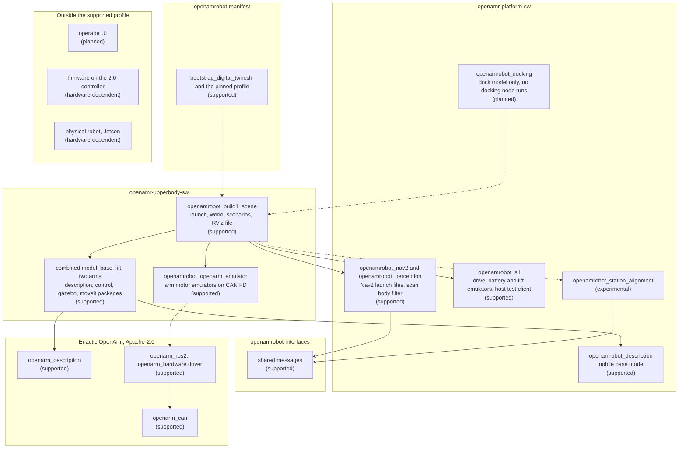
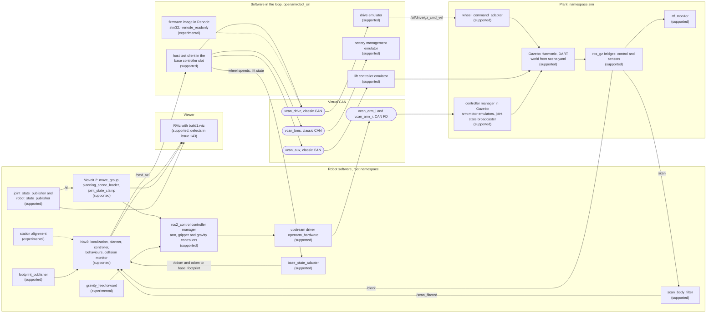
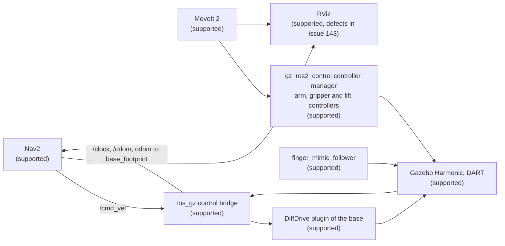

# rc.1 architecture

**For:** developers who need to know which process does what in the running twin, and where its source lives.

**Canonical source:** `launch/build1.launch.py` and `config/command_map.yaml` of `openamrobot_build1_scene` in
[openamr-upperbody-sw](https://github.com/openAMRobot/openamr-upperbody-sw), and the package `openamrobot_sil` of
[openamr-platform-sw](https://github.com/openAMRobot/openamr-platform-sw), at the candidate commits. The diagrams are
drawn from those files. They show what rc.1 starts, not the target architecture; the target is on the
[Digital twin architecture](../architecture.md) page.

!!! warning "Simulation only"
    The hardwired safety chain (E-stops, contactors, brakes, charge inhibit) is not modelled. No box in these
    diagrams is a safety function.

## Status marks

Every element carries one of four marks.

| Mark | Meaning in rc.1 |
|---|---|
| supported | part of the supported profile and exercised by the qualification runs |
| experimental | present in the candidate, switched on by an argument, not part of the qualified default or still Proposed |
| planned | not in the candidate |
| hardware-dependent | exists only with physical hardware, which rc.1 does not cover |

## System overview

Which repository provides which part, and what the twin stands in for.

Solid arrows mean "uses". Dotted arrows mean an optional or partial use: the station alignment is started only with
`station_alignment:=true`, and the docking package contributes its dock model to the world while no docking node
runs.

## Simulation runtime, profile `firmware_sil`

The default profile and the one the Baseline 1 mission runs in. Commands leave the robot software as they would on
the robot, cross a virtual CAN bus to an emulated device, and the emulator acts on the joint in Gazebo.

Reading notes, each taken from the launch file or the single-writer map of the scene:

- `/cmd_vel` has one writer, the Nav2 collision monitor. The docking nodes are not started because they would be a
  second writer.
- The lift has one command path in this profile: `/sil/lift/command` and `/sil/lift/permit` to the host test client,
  over `vcan_aux` to the lift controller emulator. MoveIt 2 does not move the lift here.
- The arm emulators emulate the CAN motor devices only. Gazebo owns the rigid-body dynamics of every joint.
- `/odom` and the transform from `odom` to `base_footprint` come from `base_state_adapter`, from wheel speeds read
  over CAN. The transform from `map` to `odom` comes from the Nav2 localization node.
- With `driver_clock:=sim` the real arm driver starts only after the first `/clock` message.
- A virtual CAN bus has no bit rate, no arbitration, no error frames and no bus-off.

## Simulation runtime, profiles `fast` and `fine`

No devices and no virtual CAN. The controllers act on Gazebo directly.

In these profiles the grippers do not move with the default DART engine; see
[Launch profiles and arguments](launch.md#physics-engines).

## What is not in the diagrams

- The hardwired safety chain, hub motor holding brakes, battery behaviour, motor current and heat, sensor noise and
  the CAN physical layer are not modelled.
- Isaac Sim, MuJoCo, LeRobot and AI policies are not part of rc.1.
- The host link between the base controller and the computer is not modelled: the host test client talks ROS
  directly.

The complete list is in
[`docs/build1_scene.md`](https://github.com/openAMRobot/openamr-upperbody-sw/blob/1ab45a62957d238fc293eee08a8fd9158acebb01/docs/build1_scene.md)
of openamr-upperbody-sw.
