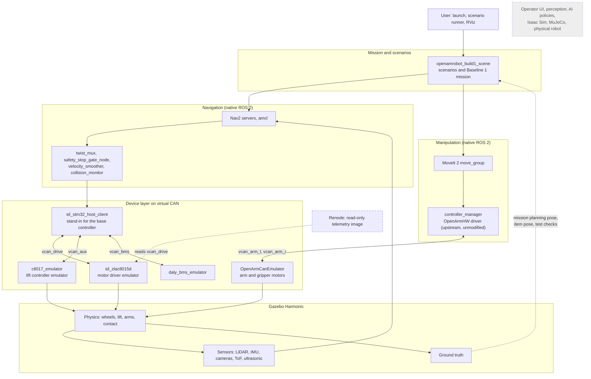
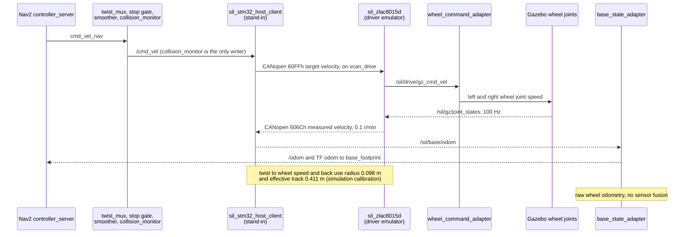
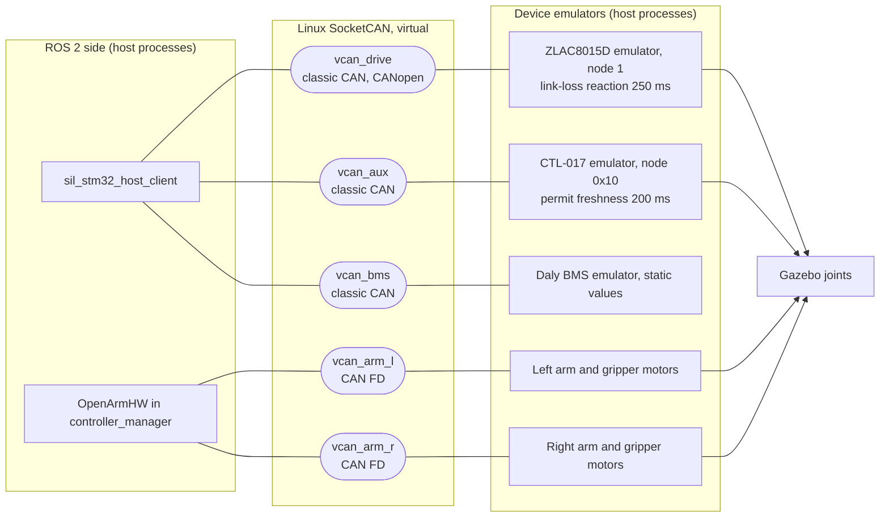
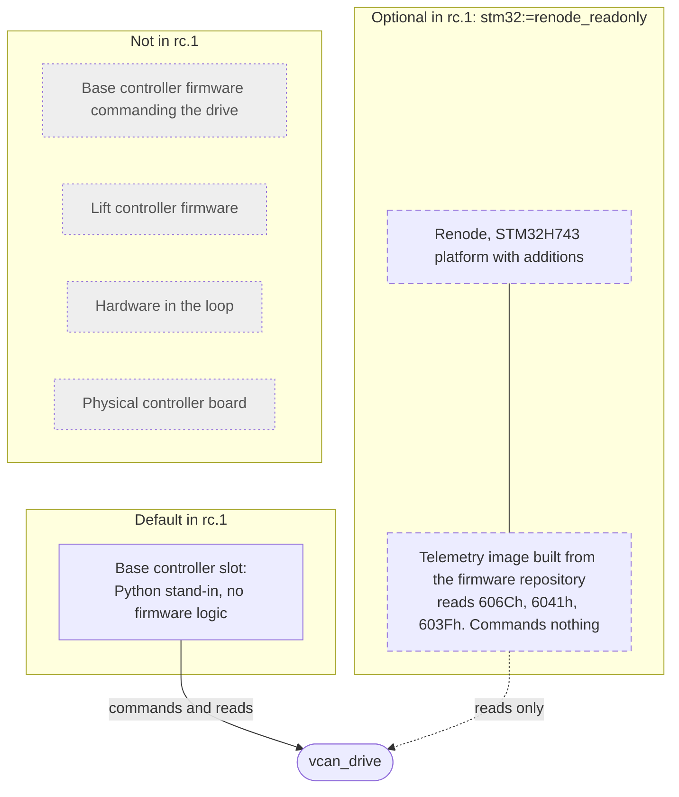
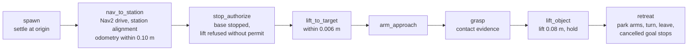

# Architecture diagrams

**For:** engineers who want the structure before the text.

Every name in these diagrams is a name in the source at platform commit `2ac4070` and upperbody commit `6687f65`. The diagrams describe the default device profile `firmware_sil` unless stated. They are written in Mermaid, so the source is this page.

**Legend, used in all diagrams**

| Style | Meaning |
|---|---|
| Solid box | Runs in rc.1 |
| Dashed box | Optional in rc.1, off by default |
| Dotted box, grey | Not in rc.1 |

## 1. System overview

The dashed arrow from ground truth matters: the whole-robot mission plans from the simulator's pose and knows the item pose from the simulator. See [Known issues and limitations](limitations.md).

## 2. Mobile base: command and feedback sequence

## 3. Virtual CAN buses and device emulators

A virtual bus carries frames only. Bit timing, arbitration, error frames and bus-off do not exist on it and are not tested.

## 4. Firmware and Renode boundary

The Renode path is tested in the platform SIL workflow. The scene tests and the mission run with the stand-in.

## 5. Whole-robot mission sequence

One leg of the Baseline 1 mission. A strict dispatch runs two legs. Phase names are those of the mission definition.

Base, lift and arm act one after the other in this mission. Nothing in rc.1 qualifies coordinated motion of base and arms.

Acceptance values per phase: [Scenario catalog](scenarios.md#baseline-1-whole-robot-mission).
