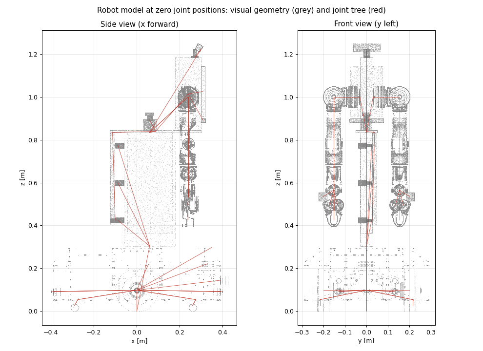

# Start here: OpenAMRobot 2.0 Digital Twin rc.1

OpenAMRobot is an open-source Embodied AI robot platform: a mobile base, a lift column and two arms, with ROS 2
software, firmware and open hardware designs. Grocery automation is the first commercial use case. **rc.1 is the
Digital Twin release candidate of OpenAMRobot 2.0:** the whole robot runs in simulation on your machine. No hardware
is needed, and none is covered.

!!! warning "Simulation only"
    Every result in this section is development evidence from simulation. None of it is physical, electrical or
    safety acceptance, and no part of the twin is a safety function.

!!! note "Release status"
    As of 28 November 2026 the candidate commits are frozen and the release metadata is merged in
    [openamrobot-release](https://github.com/openAMRobot/openamrobot-release). The tag `v2.0.0-rc.1` and the release
    page are not published yet. Lines marked "valid after publication" refer to them.

*Model geometry at zero joint positions, generated from the robot description. This is not a Gazebo screenshot or a photograph of assembled hardware.*

## Choose your starting point

-   **[Run the Digital Twin](quick-start.md)**

    Install the pinned workspace, launch Gazebo and RViz, and run the first drive demonstration.

-   **[Explore demonstrations](demonstrations.md)**

    Try navigation, lift movement and the qualified left-arm grasp. Follow the profile and engine instructions for each demo.

-   **[Explore the robot and architecture](diagrams.md)**

    View the model, runtime ROS 2 graph and engineering diagrams.

-   **[Release information](release.md)**

    Check the supported versions, source archive status, evidence and limitations. The source archive is not needed to install the twin.

[System requirements](requirements.md) · [RViz guide](rviz.md) · [Troubleshooting](troubleshooting.md) · [Media](../media.md)

## In one minute

| Question | Answer |
|---|---|
| What runs | Mobile base, 350 mm lift and two [OpenArm 2.0](https://github.com/enactic/openarm) arms in one Gazebo Harmonic world, with Nav2, MoveIt 2 and ros2_control, optionally with every device emulated on virtual CAN |
| What you can do | Drive the base, move the lift, run a qualified left-arm grasp, run 17 scene tests and the Baseline 1 mission, a sequential whole-robot mission (drive to a station, raise the lift, reach, grasp, retreat) |
| Who it is for | Developers, integrators, labs and contributors who want to work on navigation, manipulation or integration before hardware exists |
| What it needs | Ubuntu 24.04 on x86_64, `sudo`, network access. ROS 2 Jazzy and the pinned Gazebo packages are installed by the script. Minimum CPU, memory and disk are not measured: see [System requirements](requirements.md) |
| What is not in rc.1 | Operator UI, camera-driven perception (object poses come from simulator ground truth), cancel and resume, docking, Isaac Sim, MuJoCo, LeRobot and AI policies, Jetson, firmware on 2.0 hardware, physical commissioning |

## Run it

1. **Install and launch** with the [Quick start](quick-start.md): one clone, one checkout, one script, one launch
   command.
2. **See the first result:** the drive scenario `scn01_drive` ends with PASS and a JSON log, then the lift scenario.
3. **Go further** with the [Demonstrations](demonstrations.md): the grasp (it needs the Bullet Featherstone physics
   engine) and the Baseline 1 mission.

If something goes wrong, see [Troubleshooting](troubleshooting.md). [Installation](installation.md) explains each
install step and the manual equivalent of the script.

## Help, contributing and what comes next

- Questions and reports: open an issue in the repository that owns the part (see [Contribute](contributing.md)), or
  ask in [GitHub Discussions](https://github.com/orgs/openAMRobot/discussions).
- Known problems and their workarounds: [Known issues and limitations](limitations.md).
- What rc.2 and the following stages are meant to fix: [Roadmap and rc.2 plan (proposed)](roadmap.md).

## What is supported

| Supported in rc.1 | Not supported in rc.1 |
|---|---|
| Ubuntu 24.04 on x86_64, ROS 2 Jazzy, Gazebo Harmonic (pinned vendor packages), CycloneDDS | Any other operating system, ROS distribution, simulator version or middleware |
| Installation from the pinned six-repository profile with one script | The full source inventory as a buildable workspace |
| The Build 1 scene: mobile base, lift, two arms and grippers in one Gazebo world | Isaac Sim, MuJoCo |
| Nav2 navigation on a map generated from the scene, MoveIt 2 planning for both arms | Cancel and resume of a navigation goal, docking |
| Device emulators on virtual CAN with the unmodified upstream arm driver (profile `firmware_sil`) | Firmware on 2.0 hardware, Jetson, arm64 |
| Scenarios with PASS, FAIL or BLOCKED results, and the Baseline 1 mission (the whole-robot sequence: drive to a station, lift, grasp, retreat) | Operator UI (see the warning below), camera-driven manipulation (object poses come from simulator ground truth), LeRobot and AI policies |
| RViz configuration for the scene | Any physical commissioning or safety qualification |

The full list with evidence and limits is the [capability and maturity matrix](capabilities.md).

!!! danger "Operator UI: isolated simulation only"
    The operator UI is not supported in rc.1. Its pinned snapshot (`openamrobot-ui` `2cf9179`) starts rosbridge on
    port 9090 without authentication or authorization. Any client that reaches that port can publish `/cmd_vel` past
    the command gate, release the stop lock and write Nav2 parameters. A topic allowlist alone is not authentication.
    If you start the UI, do it only in an isolated simulation environment, never with powered hardware.
    Tracked in [openamrobot-ui 64](https://github.com/openAMRobot/openamrobot-ui/pull/64) and
    [openamrobot-ui 71](https://github.com/openAMRobot/openamrobot-ui/issues/71).

## In this section

| Page | Content |
|---|---|
| [System requirements](requirements.md) | What was tested and what was not |
| [Installation](installation.md) | The bootstrap script and the manual equivalent |
| [Quick start](quick-start.md) | From an empty machine to the first demonstration |
| [Launch profiles and arguments](launch.md) | Run profiles and every launch argument |
| [RViz guide](rviz.md) | Each display, what it needs and known defects |
| [Demonstrations](demonstrations.md) | Drive, lift, arms, grasp and the Baseline 1 mission (the whole-robot sequence: drive to a station, lift, grasp, retreat) |
| [Architecture](architecture.md) | Diagrams of the system and of the simulation runtime |
| [Capability and maturity](capabilities.md) | One table for every capability, with evidence and limits |
| [Troubleshooting](troubleshooting.md) | Symptoms, causes, checks and fixes |
| [Scenario catalog](scenarios.md) | All 17 scene tests (19 results) and the mission, with acceptance values and status |
| [Architecture diagrams](diagrams.md) | Twelve diagrams: ten drawn from the source, two generated from the running system |
| [Where the logic runs](execution-map.md) | What is native software, stand-in, emulation or simulation; what firmware runs |
| [Known issues and limitations](limitations.md) | Scope limits, active issues, workarounds |
| [Contribute](contributing.md) | How to test a change and where help is useful |
| [From the twin to hardware (proposed)](hardware-integration.md) | Proposal for the next work stream |
| [Roadmap and rc.2 plan (proposed)](roadmap.md) | The rc.2 plan with acceptance criteria, and the stages after it |
| [Release information](release.md) | Candidate commits, qualification runs, known limitations, licences |

Background on what a digital twin result can and cannot show: [Digital twin](../index.md).
