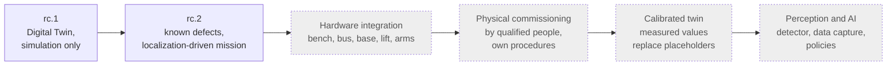

# Roadmap and rc.2 plan (proposed)

**For:** anyone who wants to know where the project goes after this release and how firm each step is.

This page gives no dates. A stage starts when the one before it has recorded results. Each line carries one of three marks:

| Mark | Meaning |
|---|---|
| **Decided** | Decided by the project owner or a maintainer and written in a repository |
| **Tracked** | An open issue exists; no one has committed to a date |
| **Proposed** | An idea on this site, not yet accepted by the owners |

## Stages

Solid: defined by issues today. Dotted: proposed. Work on the later stages can start earlier where it needs no hardware; the order is about which results depend on which.

## rc.1: this release

| Item | Mark |
|---|---|
| Scope: combined model, Gazebo Harmonic, Nav2, MoveIt 2, lift and arm control, device emulators on virtual CAN, RViz, the Baseline 1 mission, reproducible source archive, clean install | **Decided** |
| Not in scope: operator UI, camera-driven manipulation, Isaac Sim, MuJoCo, LeRobot and AI policies, compute module deployment, physical commissioning, cancel and resume of navigation | **Decided** |

## rc.2 plan (proposed)

**Proposed, not committed.** This plan is built only from open issues and the known limitations of rc.1. It is not a
gate for rc.1. No issue below has an assignee yet, so every owner is "to assign"; an item becomes committed when its
owner accepts it in the issue. No dates are given.

### Simulation reliability

| Item | Issue | Owner | Acceptance criterion |
|---|---|---|---|
| Start-up freeze: `/clock` stops after a few milliseconds | [upperbody 135](https://github.com/openAMRobot/openamr-upperbody-sw/issues/135) | to assign | 0 freezes in 30 consecutive mission start-ups on hosted CI, without the 60 s retry |
| `move_group` and `parameter_bridge` exit with -11 at shutdown | [upperbody 147](https://github.com/openAMRobot/openamr-upperbody-sw/issues/147) | to assign | a7 model tests exit with code 0 for every process in 10 consecutive runs |
| Bus frames from before a reset act after it | [platform 159](https://github.com/openAMRobot/openamr-platform-sw/issues/159) | to assign | the 3 expected failures in the SIL protocol tests turn into passes |
| SIL start-up standstill and mixed clocks | [upperbody 142](https://github.com/openAMRobot/openamr-upperbody-sw/issues/142), [upperbody 137](https://github.com/openAMRobot/openamr-upperbody-sw/issues/137) | to assign | 0 standstills in 65 `firmware_sil` launches; no link-loss event caused by clock mixing |
| Timing test fails on a slow runner | [platform 198](https://github.com/openAMRobot/openamr-platform-sw/issues/198) | to assign | `sil-tests` passes in 20 consecutive hosted runs |
| Fast DDS sample loss | [platform 197](https://github.com/openAMRobot/openamr-platform-sw/issues/197) | to assign | cause written in the issue; either the alignment job passes under Fast DDS or Fast DDS stays documented as unsupported |
| Gazebo seed and stable model hash | none yet | to assign | two launches at identical pins print the same model hash; the mission records the Gazebo seed |
| RViz defects | [upperbody 143](https://github.com/openAMRobot/openamr-upperbody-sw/issues/143) | to assign | `build1.rviz` exits with code 0 and shows ground truth; a person checks it on a real screen and records it in the issue |

### Navigation and manipulation

| Item | Issue | Owner | Acceptance criterion |
|---|---|---|---|
| Cancel and resume of a drive goal | [platform 207](https://github.com/openAMRobot/openamr-platform-sw/issues/207) | to assign | `scn07_cancel_resume` passes in 12 of 12 launches |
| Operator cancel reports ABORTED instead of CANCELED | [platform 189](https://github.com/openAMRobot/openamr-platform-sw/issues/189) | to assign | a cancelled goal ends CANCELED in 12 of 12 launches |
| Station approach stops short | [platform 201](https://github.com/openAMRobot/openamr-platform-sw/issues/201) | to assign | 0 stop-short aborts in 30 mission legs |
| Arm park in `fast` with DART | [upperbody 126](https://github.com/openAMRobot/openamr-upperbody-sw/issues/126) | to assign | `scn17_base_yaw_fast` passes and is no longer an expected failure |
| Odometry calibration of the twin | [upperbody 136](https://github.com/openAMRobot/openamr-upperbody-sw/issues/136) | to assign | yaw difference between odometry and ground truth at the station judged against a written limit in every leg |
| Mission planned from the map estimate, not ground truth | none yet | to assign | the Baseline 1 mission passes 3 of 3 with localization in the loop |
| Gate weaknesses (rc.1 limitation 11) | none yet | to assign | the liveness check fails when absent; cancellation needs every check; finger contact has a force cap; the Stop check runs on a moving base |

### Operator UI security

| Item | Issue | Owner | Acceptance criterion |
|---|---|---|---|
| rosbridge allowlist | [openamrobot-ui 64](https://github.com/openAMRobot/openamrobot-ui/pull/64) | to assign | `/cmd_vel` and every `cmd_vel_*` input are not publishable from a browser; manual drive only on `/ui/cmd_vel` |
| rosbridge authentication and privileged calls | [openamrobot-ui 71](https://github.com/openAMRobot/openamrobot-ui/issues/71) | to assign | an unauthenticated client cannot release the stop lock, write Nav2 parameters or change lifecycle states |

### Perception, data and other simulators

| Item | Issue | Owner | Acceptance criterion |
|---|---|---|---|
| Head and wrist camera streams | [upperbody 24](https://github.com/openAMRobot/openamr-upperbody-sw/issues/24) | to assign | the camera contract accepted by its owner; streams published in the scene at the contract rates |
| Object detector in place of ground truth | none yet | to assign | the grasp scenario passes with detected item poses |
| Episode recording and LeRobot conversion | [upperbody 37](https://github.com/openAMRobot/openamr-upperbody-sw/issues/37) | to assign | one simulated episode recorded as a ROS 2 bag and converted to a LeRobot dataset that loads |
| MuJoCo model of the combined robot | [upperbody 58](https://github.com/openAMRobot/openamr-upperbody-sw/issues/58) | to assign | MJCF model with a passing URDF parity test |
| Isaac Sim import | [upperbody 15](https://github.com/openAMRobot/openamr-upperbody-sw/issues/15) | to assign | the combined model imports and stands in Isaac Sim, recorded in the issue |

### Compute and hardware

| Item | Issue | Owner | Acceptance criterion |
|---|---|---|---|
| Jetson Orin NX, arm64 build | [upperbody 38](https://github.com/openAMRobot/openamr-upperbody-sw/issues/38) | to assign | the supported profile builds on arm64; the benchmark in the issue is recorded |
| STM32H723 firmware and the bench towards v2.0.0 | none yet | to assign | the bench gates are recorded with wheels off the ground first and the hardwired stop chain tested on its own record. v2.0.0 is planned for 18 December 2026, only if this evidence exists |

## Hardware integration

All **Proposed**. The reasoning, a table of reusable tests and the open review questions are on [From the Digital Twin to hardware](hardware-integration.md). In short: the same scenario definitions run against three back ends (emulators, hardware in the loop, physical robot); bus diagnostics, conformance checks, recording and a calibration procedure are built before hardware arrives.

## Physical commissioning

**Proposed** as a stage; its content is not defined on this site. Power protection, the hardwired safety chain, brakes and motor enabling are designed and verified by qualified people on the hardware, under their own approved procedures. Nothing in the Digital Twin is evidence for them.

## Calibrated twin

All **Proposed**. Replace placeholders with measured values, one at a time, each with its measurement record:

- track and wheel radius from a calibration drive, replacing the 0.411 m simulation value;
- floor and wheel friction, castors as rolling joints;
- masses and inertia from the built robot;
- sensor noise, camera parameters, IMU characteristics;
- arm joint friction and damping from a bench recording;
- device emulators checked against the delivered devices.

A difference between a recorded hardware run and the twin is a finding to record, not a number to tune away.

## Perception and AI

| Item | Mark |
|---|---|
| Camera stream contract for head and wrist cameras ([upperbody 24](https://github.com/openAMRobot/openamr-upperbody-sw/issues/24), contract Proposed) | **Tracked** |
| An object detector in place of ground truth item poses | **Proposed** |
| Record an episode in simulation and convert it to a dataset ([upperbody 37](https://github.com/openAMRobot/openamr-upperbody-sw/issues/37)) | **Tracked** |
| Policy benchmark on the 2.0 compute module ([upperbody 38](https://github.com/openAMRobot/openamr-upperbody-sw/issues/38)) | **Tracked** |
| MuJoCo model generated from the combined model ([upperbody 58](https://github.com/openAMRobot/openamr-upperbody-sw/issues/58)) | **Tracked** |
| Isaac Sim import of the combined model ([upperbody 15](https://github.com/openAMRobot/openamr-upperbody-sw/issues/15)) | **Tracked** |

## How this page changes

An item moves from Proposed to Tracked when an issue exists, and to Decided when its owner writes the decision in the repository. To propose a change, see [Contribute](contributing.md).
