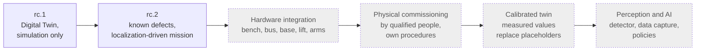

# Roadmap after rc.1

**For:** anyone who wants to know where the project goes after this release and how firm each step is.

This page gives no dates. A stage starts when the one before it has recorded results. Each line carries one of three marks:

| Mark | Meaning |
|---|---|
| **Decided** | Decided by the project owner or a maintainer and written in a repository |
| **Tracked** | An open issue exists; no one has committed to a date |
| **Proposed** | An idea on this site, not yet accepted by the owners |

## Stages

Solid: defined by issues today. Dotted: proposed. Work on the later stages can start earlier where it needs no hardware; the order is about which results depend on which.

## rc.1: this release

| Item | Mark |
|---|---|
| Scope: combined model, Gazebo Harmonic, Nav2, MoveIt 2, lift and arm control, device emulators on virtual CAN, RViz, the Baseline 1 mission, reproducible source archive, clean install | **Decided** |
| Not in scope: operator UI, camera-driven manipulation, Isaac Sim, MuJoCo, LeRobot and AI policies, compute module deployment, physical commissioning, cancel and resume of navigation | **Decided** |

## rc.2: defects and the gaps the qualification showed

| Item | Mark |
|---|---|
| Cancel and resume of a drive goal ([platform 207](https://github.com/openAMRobot/openamr-platform-sw/issues/207)) | **Tracked** |
| Station approach stops short ([platform 201](https://github.com/openAMRobot/openamr-platform-sw/issues/201), filed for rc.2) | **Tracked** |
| Arm joint on its lower limit does not move with DART in `fast` ([upperbody 126](https://github.com/openAMRobot/openamr-upperbody-sw/issues/126)) | **Tracked** |
| Start-up freeze of the simulation ([upperbody 135](https://github.com/openAMRobot/openamr-upperbody-sw/issues/135)) | **Tracked** |
| Bus frames from before a reset act after it ([platform 159](https://github.com/openAMRobot/openamr-platform-sw/issues/159)) | **Tracked** |
| Fast DDS alignment failure ([platform 197](https://github.com/openAMRobot/openamr-platform-sw/issues/197)) | **Tracked** |
| RViz defects ([upperbody 143](https://github.com/openAMRobot/openamr-upperbody-sw/issues/143)) | **Tracked** |
| A mission run that plans from the map estimate, not from simulation ground truth | **Proposed** |
| An effective seed and a stable model hash, so that two runs can be compared | **Proposed** |
| Clean exit of `move_group` and the bridge at shutdown | **Proposed** |
| A judged limit for the yaw difference between odometry and ground truth | **Proposed** |

## Hardware integration

All **Proposed**. The reasoning, a table of reusable tests and the open review questions are on [From the Digital Twin to hardware](hardware-integration.md). In short: the same scenario definitions run against three back ends (emulators, hardware in the loop, physical robot); bus diagnostics, conformance checks, recording and a calibration procedure are built before hardware arrives.

## Physical commissioning

**Proposed** as a stage; its content is not defined on this site. Power protection, the hardwired safety chain, brakes and motor enabling are designed and verified by qualified people on the hardware, under their own approved procedures. Nothing in the Digital Twin is evidence for them.

## Calibrated twin

All **Proposed**. Replace placeholders with measured values, one at a time, each with its measurement record:

- track and wheel radius from a calibration drive, replacing the 0.411 m simulation value;
- floor and wheel friction, castors as rolling joints;
- masses and inertia from the built robot;
- sensor noise, camera parameters, IMU characteristics;
- arm joint friction and damping from a bench recording;
- device emulators checked against the delivered devices.

A difference between a recorded hardware run and the twin is a finding to record, not a number to tune away.

## Perception and AI

| Item | Mark |
|---|---|
| Camera stream contract for head and wrist cameras ([upperbody 24](https://github.com/openAMRobot/openamr-upperbody-sw/issues/24), contract Proposed) | **Tracked** |
| An object detector in place of ground truth item poses | **Proposed** |
| Record an episode in simulation and convert it to a dataset ([upperbody 37](https://github.com/openAMRobot/openamr-upperbody-sw/issues/37)) | **Tracked** |
| Policy benchmark on the 2.0 compute module ([upperbody 38](https://github.com/openAMRobot/openamr-upperbody-sw/issues/38)) | **Tracked** |
| MuJoCo model generated from the combined model ([upperbody 58](https://github.com/openAMRobot/openamr-upperbody-sw/issues/58)) | **Tracked** |
| Isaac Sim import of the combined model ([upperbody 15](https://github.com/openAMRobot/openamr-upperbody-sw/issues/15)) | **Tracked** |

## How this page changes

An item moves from Proposed to Tracked when an issue exists, and to Decided when its owner writes the decision in the repository. To propose a change, see [Contribute](contributing.md).
