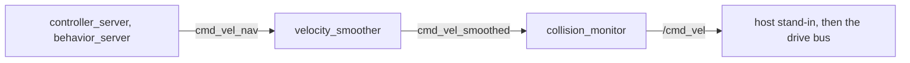
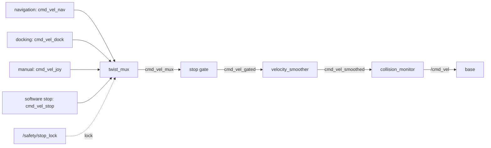

# ROS 2 software graph

**For:** engineers who want to find a node, a topic or the writer of a command.

**Canonical source:** the single-writer map of the Build 1 scene
([`config/command_map.yaml`](https://github.com/openAMRobot/openamr-upperbody-sw/blob/196dd3fe64900ba4a12124c9ee20e0cfaafa1651/ros2/src/openamrobot_build1_scene/config/command_map.yaml)
and the README tables) and `openamrobot_nav2` in openamr-platform-sw. Topic names, messages and launch arguments are
contracts of those repositories; this page does not define them.

!!! warning "Simulation, not hardware validation"
    The software Stop described here is a functional stop. It is not a safety function.

## Main nodes

| Area | Nodes | Package |
|---|---|---|
| Navigation | `bt_navigator`, `controller_server`, `planner_server`, `behavior_server`, `velocity_smoother`, `collision_monitor`, `amcl`, `map_server` | Nav2 with `openamrobot_nav2` configuration |
| Station approach | station behaviour tree (`navigate_to_station.xml`), marker alignment `/station_alignment/navigate_to_station` | openamr-platform-sw #164, #167 (both open, on the integration branch) |
| Arms | `move_group`, `{left,right}_arm_controller`, `{left,right}_gripper_controller`, `{left,right}_arm_gravity_controller`, `joint_state_broadcaster` | MoveIt 2, ros2_control, the OpenArm driver |
| Devices | host stand-in, ZLAC8015D, CTL-017 and BMS emulators | `openamrobot_sil` |
| Scene glue | `base_state_adapter`, `wheel_command_adapter`, `planning_scene_loader`, `footprint_publisher`, `joint_state_publisher`, `robot_state_publisher`, the Gazebo bridge | `openamrobot_build1_scene` |

## Velocity command chain

In the twin today (integration branch, Baseline 1 runs):

`collision_monitor` is the only writer of `/cmd_vel`. No `twist_mux` and no stop gate run. The docking nodes are not
started (`use_docking` false), because the docking trigger also writes `/cmd_vel`.

With the command arbitration of openamr-platform-sw
[#90](https://github.com/openAMRobot/openamr-platform-sw/pull/90) (open, safety-adjacent, two-person review):

twist_mux priorities in #90: navigation 10, docking 20, manual 100, software stop 255; the stop lock masks every input
below 255. #90 also puts goal proxies on `navigate_to_pose` and `navigate_through_poses` so that a Stop cancels every
goal, and removes the reversing behaviours. Until #90 is merged and adopted into the twin, nothing that bypasses Nav2
(for example a browser joystick) may be connected to the twin; see [Operator UI and Control Room](operator-ui.md).

## Nav2 configuration

- Planner and controller from `openamrobot_nav2/config/nav2_params.yaml` of the pinned platform commit.
- Station approach: a behaviour tree that approaches the shelf and, with alignment on, a marker-based final alignment
  from a simulation-only base camera.
- Reverse: the platform integration branch still allows a 0.30 m backup. The no-reverse configuration (spin and wait
  behaviours only, minimum velocity 0, platform-sw [#178](https://github.com/openAMRobot/openamr-platform-sw/pull/178),
  open) with the turn-and-forward departure is the approved direction. [Scenarios](scenarios.md) records which one a
  run used.
- AMCL against the scene map; the `map` to `odom` transform is AMCL's.

## MoveIt 2 and ros2_control

- MoveIt plans both arms with a fixed base. `planning_scene_loader` places shelves, tote and item relative to the
  robot. In the sim-oracle profile those poses come from Gazebo ground truth, declared in every run; this is not a
  perception result.
- In the device profiles MoveIt does not move the lift. The lift moves between calibrated stops through the CTL-017
  path only.
- The arm controllers run in the root controller manager with the real OpenArm driver; the motor emulators run in a
  second controller manager inside Gazebo (`/sim`). Gravity feed-forward goes through the driver's effort interface.

## Frames

One TF tree in every profile: `map` > `odom` > `base_footprint` > `base_link` > lift > arms. `/odom` is raw wheel
odometry from `base_state_adapter`, no filter.

## Middleware

The acceptance runs use CycloneDDS (`rmw_cyclonedds_cpp`) with `MaxAutoParticipantIndex` 120. Fast DDS lost camera and
pose samples under the Baseline 1 load.
